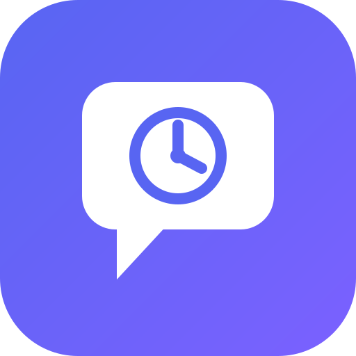

  

<h1 align="center">Nicord</h1>

  Ứng dụng máy tính gửi tin nhắn Discord tự động, theo lịch bạn đặt.

  
  

---

## Nicord là gì?

Nicord giúp bạn **gửi tin nhắn vào Discord một cách tự động**, vào đúng giờ bạn hẹn, với nội dung bạn soạn sẵn.

Ví dụ bạn có thể dùng Nicord để:

- Chào buổi sáng cả server mỗi ngày lúc 8 giờ.
- Nhắc lịch sự kiện, lịch họp, lịch học mỗi tuần.
- Gửi thông báo, tin khuyến mãi, tin cập nhật theo giờ cố định.
- Xoay vòng nhiều mẫu tin khác nhau, để tin nhắn không bị lặp đi lặp lại giống hệt nhau.

Bạn chỉ cần mở app, soạn nội dung, đặt lịch, rồi để app chạy.

> ⚠️ **ĐỌC TRƯỚC KHI DÙNG — RẤT QUAN TRỌNG**
>
> Discord **cấm** việc tự động hoá tài khoản người dùng thường (gọi là "self-bot"). Nếu bị Discord phát hiện, tài khoản của bạn **có thể bị khoá vĩnh viễn**.
>
> Nicord có nhiều biện pháp để **giảm** rủi ro, nhưng **không thể hứa là bạn sẽ không bao giờ bị khoá**.
>
> 👉 **Hãy dùng một tài khoản phụ để thử. Đừng dùng tài khoản chính** có server, bạn bè hay Nitro quan trọng. Bạn tự chịu trách nhiệm với tài khoản của mình khi dùng Nicord.
>
> Muốn an toàn hơn? Dùng **chế độ Webhook** — cách chính thức của Discord, không dùng tài khoản của bạn để gửi.

---

## Tính năng chính

### Nhiều kênh, mỗi kênh một kiểu (Webhook — khuyến nghị)

- Mỗi kênh là một đích đến với webhook chính thức của Discord, có cài đặt riêng: tên hiển thị, giới hạn gửi mỗi ngày, khoảng nghỉ tối thiểu, khung giờ im lặng, tin nhắn mặc định.
- Theo dõi trạng thái từng kênh: webhook còn tốt không, hôm nay đã gửi bao nhiêu, lần tới gửi khi nào. Kênh gặp lỗi sẽ tự tạm dừng, các kênh khác vẫn chạy bình thường.
- Gửi vào thread trong kênh, nếu bạn muốn.

### Soạn tin nhắn như trong Discord

- Xem trước tin nhắn đúng kiểu Discord ngay khi gõ, kèm đếm ký tự; tin quá 2000 ký tự sẽ bị chặn trước khi gửi.
- Thư viện mẫu tin dùng lại, xoay vòng nhiều mẫu, spin text, biến ngày/giờ.
- Embed với tiêu đề, mô tả, màu sắc và trường thông tin; bảng chọn emoji.

### Lịch gửi linh hoạt

- Lặp mỗi 30 phút, mỗi giờ, mỗi ngày, mỗi tuần, giờ tự chọn, hoặc lịch nâng cao (cron) — mỗi lịch có múi giờ riêng.
- Khung giờ im lặng riêng cho từng kênh, kể cả qua đêm.

### Theo dõi và kiểm soát

- Dashboard tổng quan và trạng thái từng kênh, kèm báo cáo tình trạng khi mở app, chỉ ra lỗi cần sửa và chỗ sửa.
- Lịch sử gửi đầy đủ, lọc theo từ khóa, trạng thái, kịch bản và kênh; xuất ra file CSV.
- Xóa một tin đã gửi ngay từ lịch sử — chỉ khi bạn bấm và xác nhận.
- Âm báo khi gửi lỗi hoặc kênh bị tạm dừng, bật/tắt tùy ý.
- Tìm kiếm kịch bản, bật/tắt hàng loạt, và phím tắt cho các thao tác thường dùng.

### Mang cấu hình theo máy

- Xuất toàn bộ cấu hình (cài đặt, đích đến, kịch bản, mẫu tin) ra một file để chuyển sang máy khác, có mật khẩu bảo vệ khi gồm thông tin đăng nhập. Nhập lại sẽ thay thế toàn bộ và luôn có bản sao lưu tự động trước đó.

### Cá nhân hóa

- Giao diện tiếng Việt và English, chuyển ngay lập tức.
- Giao diện Tối và Sáng, cỡ chữ Nhỏ/Vừa/Lớn.
- Cửa sổ tự ghi nhớ kích thước và vị trí, có thể mở thu nhỏ khi khởi động.

---

## Bắt đầu trong 5 phút (Webhook)

### Bước 1 — Tạo webhook trong Discord

Trong Discord, bấm chuột phải vào kênh bạn muốn gửi → **Edit Channel** → **Integrations** → **Webhooks** → **New Webhook**. Đặt tên cho webhook (tên này sẽ hiện khi tin nhắn được gửi), rồi bấm **Copy Webhook URL**.

URL webhook **là mật khẩu** — ai có URL đều gửi được tin vào kênh đó. Nicord mã hóa URL và chỉ lưu trên máy bạn. Nếu URL bị lộ, hãy xóa webhook cũ và tạo webhook mới trong Discord.

### Bước 2 — Thêm kênh vào Nicord

Mở Nicord, chọn **Webhook** ở màn hình đầu tiên, dán URL vào, bấm **Kiểm tra webhook** để xem đúng kênh chưa, rồi lưu. Thêm bao nhiêu kênh tùy bạn, mỗi kênh một webhook.

### Bước 3 — Soạn kịch bản và đặt lịch

Một kịch bản gồm: **nội dung + lịch gửi**. Soạn nhiều mẫu tin để app xoay vòng, đặt lịch gửi, rồi bấm **gửi thử 1 tin** để chắc chắn mọi thứ đúng.

### Bước 4 — Bật chạy

Bấm **Start engine** để app bắt đầu chạy theo lịch. Giữ cửa sổ app mở (bấm thu nhỏ cũng được). **Đóng cửa sổ thì app sẽ dừng gửi.**

---

## Chế độ Tài khoản (tùy chọn)

Ở chế độ này, tin nhắn gửi đi hiện như chính bạn gửi — không cần mời bot vào server, không cần lập trình. Bạn dán token Discord của mình một lần duy nhất; Nicord mã hoá token và chỉ lưu trên máy bạn, **không bao giờ chia sẻ token cho bất kỳ ai**.

Chế độ Tài khoản chỉ gửi tới **1 kênh duy nhất**. Webhook không gửi được lệnh (prefix/slash), không hiện "đang gõ...", không tự xóa tin — các kịch bản có lệnh sẽ bị từ chối ở chế độ Webhook. Bạn có thể đổi qua lại giữa hai chế độ trong Cài đặt; thông tin đã lưu của chế độ kia không bị xóa.

---

## Câu hỏi thường gặp

**Nicord có làm tài khoản của tôi bị khoá không?**
Có thể, ở chế độ Tài khoản. Discord cấm tự động hoá tài khoản thường, và không có cách nào an toàn tuyệt đối. Hãy dùng tài khoản phụ, hoặc dùng chế độ Webhook.

**Nicord có lấy token hay tin nhắn của tôi không?**
Không. Mọi thứ lưu trên máy của bạn, thông tin đăng nhập được mã hoá. App không gửi token hay nội dung của bạn đi đâu khác ngoài Discord.

**Tôi có cần mời bot vào server không?**
Không, ở cả hai chế độ.

**Tắt máy thì tin nhắn có được gửi bù không?**
Không. Những lần hẹn trong lúc máy tắt sẽ bị bỏ qua, app chỉ gửi lần hẹn tiếp theo. App không gửi dồn dập để bù.

**App có chạy ẩn dưới khay hệ thống (tray) không?**
Trên Windows thì có: bật "Thu nhỏ xuống khay hệ thống" trong Cài đặt. Trên Linux, bạn cần giữ cửa sổ app mở (có thể thu nhỏ). Tự chạy cùng máy tính đã có trên cả Windows và Linux.

**App chạy trên máy nào?**
Windows, macOS và Linux.

---

## Tải về và cài đặt

Hiện tại chưa có file cài đặt sẵn. Hướng dẫn build từ mã nguồn có trong [docs/TECHNICAL.md](docs/TECHNICAL.md).

---

## Tìm hiểu thêm

Mọi chi tiết khác đều nằm trong thư mục [`docs/`](docs/):

- [docs/TECHNICAL.md](docs/TECHNICAL.md) — build, cài đặt, cách hoạt động, giới hạn đã biết
- [docs/ARCHITECTURE.md](docs/ARCHITECTURE.md) — kiến trúc và luồng dữ liệu
- [docs/CONFIG-RULES.md](docs/CONFIG-RULES.md) — quy tắc lưu cấu hình và xuất/nhập
- [examples/scenario-example.json](examples/scenario-example.json) — ví dụ một kịch bản mẫu

Giấy phép: MIT.

---

## English summary

Nicord is a lightweight desktop app that sends scheduled messages to Discord. Webhook mode (recommended, Discord's official way) supports many channels, each with its own settings, schedules, limits and quiet hours. Compose with a Discord-style preview, templates, embeds and emoji; track every destination on the dashboard; export your whole setup to move to another machine. Account mode sends as yourself to a single channel — automating a normal Discord account ("self-bot") violates Discord's Terms of Service and can get your account permanently banned, so use a spare account. See [docs/TECHNICAL.md](docs/TECHNICAL.md) for details.
